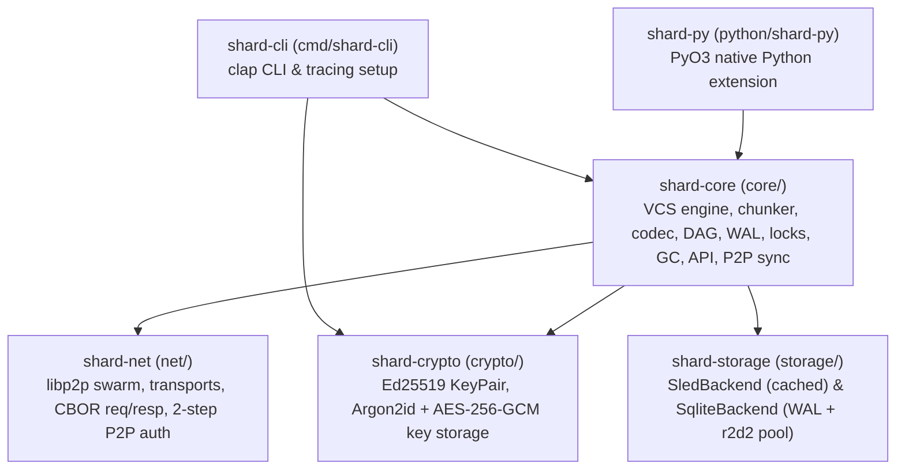

# Shard Architecture

This document provides a high-level architectural overview of the Shard workspace for contributors, security reviewers, and enterprise evaluators. For detailed chapters, see the mdBook documentation in [`docs/src/`](docs/src/SUMMARY.md).

---

## Workspace Crate Graph

Shard is organized into five publishable Rust crates plus native Python bindings (`python/shard-py`) and cross-crate integration tests (`tests/`):



---

## Core Subsystems

### 1. Storage Backends & Snapshots (`core/src/store/`, `storage/`)
Shard supports three content-addressed object store backends behind `shard_core::store::Store`:
- **`FlatStore` (default)**: Stores each object at `.shard/objects/<2-hex>/<64-hex>` using crash-safe atomic temp-file + `sync_all()` + rename writes. Every object ID is validated as 64 lowercase hex characters.
- **`SledBackend`**: Embedded key-value store at `.shard/objects.db/` with an in-process canonical-path weak handle cache so nested opens (e.g., auto-pull + background GC) never fail with Sled's exclusive file lock.
- **`SqliteBackend`**: Pooled SQLite database at `.shard/objects.db` via `r2d2` (max 8 connections) configured with `PRAGMA journal_mode=WAL`, `PRAGMA synchronous=NORMAL`, and `PRAGMA busy_timeout=5000`. Before standalone snapshots (`hf push`), `checkpoint_for_snapshot()` executes `PRAGMA wal_checkpoint(TRUNCATE)` under an exclusive repository lock.

### 2. Concurrency & Crash Recovery (`core/src/ops.rs`, `core/src/wal.rs`)
- **Dual Locking**: Every repository operation runs inside `with_read_op` or `with_write_op`, acquiring an in-process writer-preferring `RwLock` followed by an OS-level advisory lock (`fs2`) on `<repo_root>/.shard.lock`. Placing `.shard.lock` at the repo root guarantees even concurrent `shard init` calls are serialized.
- **Write-Ahead Log**: Commits write a CRC32-checksummed `CommitBegin` record backing up `HEAD`, active branch ref, and `index` before mutating metadata, flush the object store first, and truncate the WAL only after `CommitEnd`. `shard recover` (and automatic startup recovery on write ops) restores clean state if interrupted.

### 3. Self-Describing `SHRD` v1 Chunk Codec (`core/src/chunk_codec.rs`)
Chunks are addressed by `blake3(plaintext)` and stored inside an 8-byte self-describing envelope:

```text
Offset  Size  Field
0..4    4     Magic: b"SHRD"
4       1     Version: 1
5       1     Flags: bits 0..2 = compression (0=none, 1=zstd, 2=zlib); bit 2 (0x04) = AES-256-GCM encrypted
6..8    2     Reserved: 0x00, 0x00
8..     N     Payload (compressed plaintext, or AES-256-GCM ciphertext with AAD = chunk_id UTF-8 bytes)
```

Because compression and encryption flags travel with each object, changing repository compression settings never breaks deduplication or historical reads, and binding `chunk_id` as AAD prevents chunk-swapping attacks on private repositories. Legacy headerless blobs remain readable for backward compatibility.

### 4. P2P Protocol & Security (`net/`, `core/src/p2p_sync.rs`)
- **Transports & NAT Traversal**: `libp2p` with TCP + Noise + Yamux and QUIC, DNS resolution, mDNS LAN discovery, Kademlia DHT, Gossipsub announcements (`shard:ann` and `/shard/repo/<repo_id>`), CBOR request-response (`/shard/1`), Circuit Relay v2, DCUtR, and AutoNAT.
- **2-Step Ed25519 Challenge-Response Auth**:
  1. Client sends `Authenticate { public_key }`.
  2. Server checks authorization policy and responds with `AuthChallenge { nonce }` (32 CSPRNG bytes, 30-second TTL).
  3. Client signs `b"shard-p2p-auth-v1:" || len(client_peer) || client_peer || len(server_peer) || server_peer || nonce` with its Ed25519 signing key and sends `AuthAnswer { signature }`.
  4. Server verifies signature + authorization and responds with `AuthGranted` or `AuthDenied`.
- **Abuse & SSRF Controls**: `PeerRateLimiter` enforces sliding-window per-peer limits (`rate_limit_max_requests` / `rate_limit_window_secs`) on both `share` and `sync`. `sync` restricts auto-pulls to the repository's own topic and peers already present in its trusted `address_book` (`peers.json`, mDNS, or dialed connections).

### 5. HTTP API & Safe Integrations (`core/src/api.rs`, `core/src/backup.rs`, `core/src/hf.rs`)
- **HTTP API (`shard serve`)**: Axum server with constant-time bearer token auth (`SHARD_API_TOKEN` or ephemeral 256-bit token), deny-by-default CORS (`SHARD_API_CORS_ORIGINS`), and `safe_repo_join` confinement on `/api/v1/add`.
- **Backup & Restore**: `restore` strictly confines tar entries inside `.shard/` and rejects traversal, symlinks, hard links, and special files.
- **HuggingFace Sync**: `stage_hf_export` checkpoints SQLite/Sled, copies only allowlisted public files, and aborts if any secret key, WAL, partial transfer, or lock file appears in the staging tree.

---

## Further Reading

- [Introduction](docs/src/introduction.md)
- [Getting Started](docs/src/getting-started.md)
- [CLI Reference](docs/src/cli.md)
- [Detailed Architecture & Storage Layout](docs/src/architecture.md)
- [Wire Protocol Specification](docs/src/protocol.md)
- [Security Policy & Threat Model](SECURITY.md)
