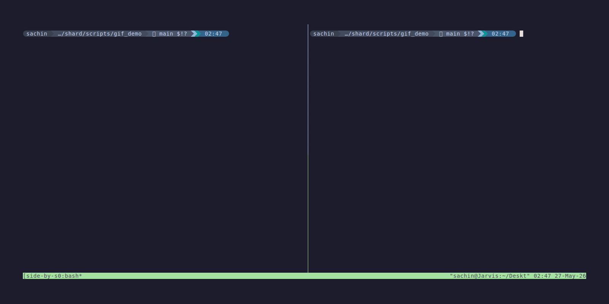
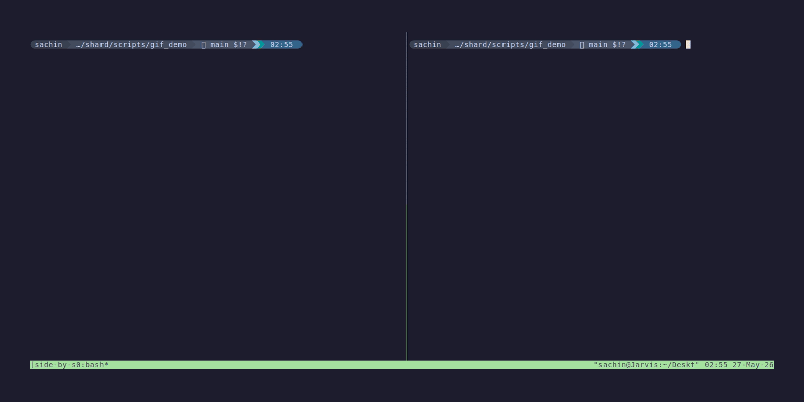
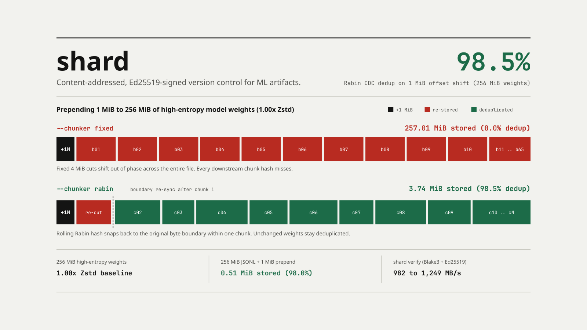
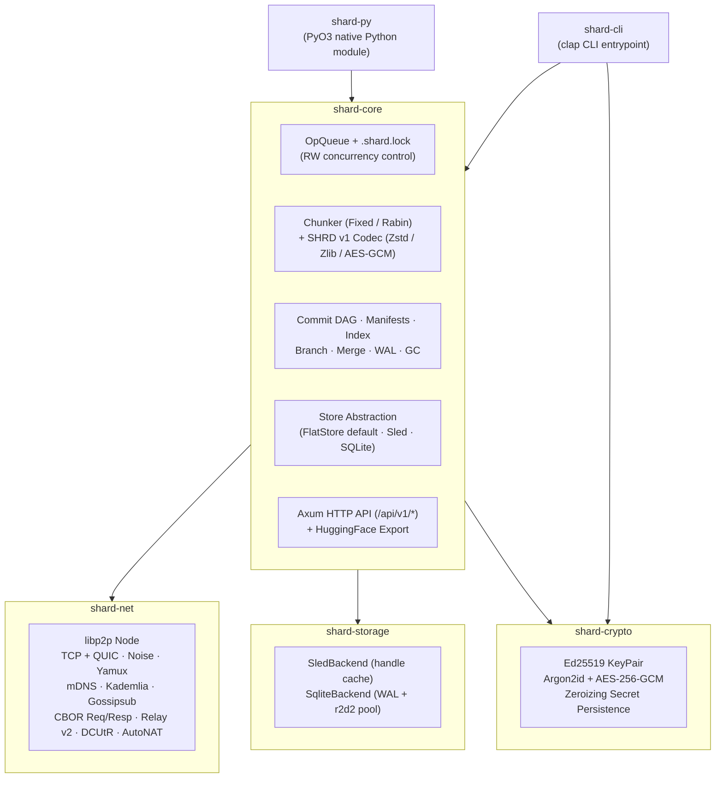

<div align="center">
  <h1>💎 Shard</h1>

  <p><b>Local-first, content-addressed, peer-to-peer version control for large machine learning artifacts.</b></p>

  <p>
    Local-first with zero cloud lock-in · Ed25519-signed commit DAGs · Content-defined chunk deduplication · Direct libp2p sync
  </p>

  [](LICENSE)
  [](https://www.rust-lang.org)
  [](https://crates.io/crates/shard-cli)
  [](https://docs.rs/shard-core)
  [](https://pypi.org/project/shard-py/)
  [](https://sandy-sachin7.github.io/shard/)
  [](https://github.com/sandy-sachin7/shard/actions)
  [](https://github.com/sandy-sachin7/shard/releases)
  [](CONTRIBUTING.md)

  <br />
  <br />
  <a href="#install"><b>Install</b></a> •
  <a href="#quick-start"><b>Quick Start</b></a> •
  <a href="#security--enterprise-guarantees"><b>Security</b></a> •
  <a href="#architecture"><b>Architecture</b></a> •
  <a href="#commands"><b>Commands</b></a>
</div>

---

<div align="center">
  <h3>Day 1: Initial Checkpoint (500MB)</h3>
  

  <h3>Day 2: Incremental Checkpoint (Appending 1MB to a 500MB file)</h3>
  
  <p><i>While Git LFS re-uploads the entire file, Shard's Rabin CDC detects and stores only the modified chunks.</i></p>
</div>

---

## Install

**Python (pip)**

```bash
pip install shard-py
```

**Linux & macOS (one-liner)**

```bash
curl -fsSL https://raw.githubusercontent.com/sandy-sachin7/shard/main/scripts/install.sh | bash
```

**Windows (PowerShell)**

```powershell
irm https://raw.githubusercontent.com/sandy-sachin7/shard/main/scripts/install.ps1 | iex
```

**Cargo**

```bash
cargo install shard-cli
```

**Build from source (Rust 1.89+)**

```bash
git clone https://github.com/sandy-sachin7/shard.git
cd shard
cargo build --release
./target/release/shard --help
```

**Install from local source**

```bash
cargo install --path cmd/shard-cli
```

---

## Performance (Measured)

<p align="center">
  
</p>

All numbers below are **measured** on Linux x86_64 (AMD Ryzen 5 5600H, 12 logical CPUs) with `shard-cli 2.4.1` using [`benchmarks/bench_real.py`](benchmarks/bench_real.py) across 256 MiB artifacts — covering both **high-entropy binary weights** (incompressible `1.00×`, representative of trained FP16/BF16 tensors) and **structured JSONL datasets** (compressible with Zstd):

| Scenario (256 MiB artifact) | Chunker | v1 Store Size (Compression) | v2 Incremental Delta Stored | Dedup Savings | `shard verify` | `shard checkout` |
| :--- | :---: | :---: | :---: | :---: | :---: | :---: |
| **High-entropy weights + 5% append (12.8 MiB)** | `fixed` | 256.01 MiB (`1.00×`) | **12.81 MiB** | **95.0%** | 238 MB/s | 206 MB/s |
| **High-entropy weights + 5% append (12.8 MiB)** | `rabin` | 256.01 MiB (`1.00×`) | **16.90 MiB** | **93.4%** | 358 MB/s | 267 MB/s |
| **High-entropy weights + 1 MiB prepend (offset shift)** | `fixed` | 256.01 MiB (`1.00×`) | 257.01 MiB | 0.0% | 479 MB/s | 424 MB/s |
| **High-entropy weights + 1 MiB prepend (offset shift)** | `rabin` | 256.01 MiB (`1.00×`) | **3.74 MiB** | **98.5%** | **982 MB/s** | **622 MB/s** |
| **JSONL dataset + 1 MiB prepend (offset shift)** | `fixed` | 25.00 MiB (`10.25×`) | 24.96 MiB | 0.1% | 1,249 MB/s | 666 MB/s |
| **JSONL dataset + 1 MiB prepend (offset shift)** | `rabin` | 25.05 MiB (`10.23×`) | **0.51 MiB** | **98.0%** | **1,204 MB/s** | 487 MB/s |

> **Honest takeaway:** Trained neural-network weights (FP16/BF16/FP32) are high-entropy and do **not** shrink meaningfully under Zstd (`~1.00×`), whereas text/JSONL/tabular datasets routinely compress `5–10×`. Shard's main storage and sync win on checkpoints comes from **content-defined chunk deduplication**: when headers or tensors shift offsets (`+1 MiB prepend`), fixed-size chunking re-stores 100% of the file while `--chunker rabin` deduplicates **98.5%** of unchanged bytes.

Reproduce locally with `python3 benchmarks/bench_real.py --size-mb 256`, `cargo bench`, or measure real LAN transfer between two machines with `./benchmarks/p2p_bench.sh` (see [benchmarks/METHODOLOGY.md](benchmarks/METHODOLOGY.md)).

```bash
# Track a base model checkpoint
shard init --chunker rabin
shard add model.pt
shard commit -m "base model" --author "Alice <alice@ml.dev>"

# After training epoch 50 (only changed chunks are stored & synced)
shard add model.pt
shard commit -m "epoch 50" --author "Alice <alice@ml.dev>"
```

---

## Python API

Shard ships native Rust-backed Python bindings (`shard-py`) via PyO3 — no external CLI binary required:

```python
import shard

# Initialize repo and track model weights
shard.init(repo_path=".", private=False)
shard.add("model.pt", repo_path=".")
res = shard.commit("base model", repo_path=".", author="Alice <alice@ml.dev>")
print("Committed:", res.commit_id)

# Later in your training loop:
shard.add("model.pt", repo_path=".")
shard.commit("epoch 50", repo_path=".", author="Alice <alice@ml.dev>")
```

---

## Quick Start

```bash
# Initialize a repository (default: flat store, zstd compression, fixed 4 MiB chunks)
shard init

# Add files or directories recursively (respects .shardignore)
shard add model.pt
shard add dataset/

# Create a cryptographically signed commit
shard commit -m "v1 checkpoint" --author "Alice <alice@ml.dev>"

# Inspect history and working tree
shard log
shard log --json
shard status --porcelain

# Verify Blake3 content hashes, Merkle roots, and Ed25519 signature
shard verify <commit_id>

# Restore files from a commit or branch
shard checkout <commit_id>

# Share over P2P (prints your /ip4/.../tcp/<port>/p2p/<peer_id> multiaddr)
shard share --listen /ip4/0.0.0.0/tcp/9876

# Pull from a peer using its full multiaddr including /p2p/<peer_id>
shard pull /ip4/192.168.1.2/tcp/9876/p2p/<peer_id> <commit_id>

# Branching and merging
shard branch create experiment
shard checkout experiment
shard add model.pt
shard commit -m "experimental changes" --author "Alice <alice@ml.dev>"
shard checkout main
shard merge experiment -m "merge experiment" --author "Alice <alice@ml.dev>"

# Backup, restore, export, and import
shard backup /tmp/repo-backup.tar.gz
shard restore /tmp/repo-backup.tar.gz
shard export <commit_id> /tmp/reconstructed
shard import /tmp/datasets -m "imported dataset" --author "Alice <alice@ml.dev>"

# Push sanitized repo artifacts to HuggingFace Datasets (private keys excluded)
export HF_TOKEN="hf_..."
shard hf push your-org/my-model-repo
```

---

## Security & Enterprise Guarantees

Shard v2.4.1 is engineered for verifiable, defense-in-depth ML artifact workflows:

- **Cryptographic Provenance & Trust Anchors**: Every commit and manifest is canonicalized and signed with Ed25519. `shard verify` enforces trust-anchor membership (local keychain + `authorized_keys`), key rotation validity windows, Blake3 content hashes, and manifest Merkle roots (rejecting unsigned commits unless `--allow-unsigned` is explicitly passed).
- **Authenticated Encryption at Rest (`SHRD` v1)**: Private repositories (`shard init --private`) encrypt each chunk inside an 8-byte self-describing `SHRD` v1 envelope using AES-256-GCM with `chunk_id` bound as Associated Authenticated Data (AAD), preventing cross-chunk swapping. Secret keys are encrypted with Argon2id + AES-256-GCM, persisted atomically with `0o600` permissions, and zeroized in memory (`zeroize`).
- **Authenticated P2P Protocol & SSRF Defense**: P2P writes (and reads when `authorized_keys` is configured) require a 2-step domain-separated Ed25519 challenge-response handshake (`shard-p2p-auth-v1:`) bound to both peer IDs and a 32-byte server nonce with a 30-second TTL. `shard sync` only auto-pulls from peers present in its verified `address_book` (`peers.json`, mDNS, or established dialed connections) on the repository's own topic — never dialing arbitrary multiaddrs advertised over Gossipsub.
- **Crash Safety & Cross-Process Concurrency**: Mutations record a CRC32-checksummed Write-Ahead Log (`wal.log`) and use atomic temp-file + `fsync` + rename writes. Every repository operation acquires both an in-process read/write lock and an OS-level advisory lock on `.shard.lock` (`fs2`).
- **Safe Backup, Restore & HuggingFace Export**: `shard restore` strictly confines tar archive entries inside `.shard/`, rejecting path traversal, symlinks, hard links, and special files. `shard hf push` checkpoints SQLite WAL (`PRAGMA wal_checkpoint(TRUNCATE)`) / flushes Sled under an exclusive write lock and enforces a mandatory secret-exclusion preflight so `secret.key`, `repo.key`, `archive/`, `wal.log`, and lock files are never uploaded.
- **Hardened HTTP API**: `shard serve` enforces constant-time bearer token authentication (`SHARD_API_TOKEN` or ephemeral CSPRNG token) on all `/api/v1/*` routes, denies cross-origin requests by default (explicit allowlist via `SHARD_API_CORS_ORIGINS`), and confines file paths strictly inside the repository root.

See [SECURITY.md](SECURITY.md) for the full threat model, cryptographic primitives, and vulnerability disclosure process.

---

## Commands

| Command | What it does | Key flags |
| :--- | :--- | :--- |
| `init` | Initialize a repository | `--private`, `--db flat\|sled\|sqlite`, `--compression zstd\|zlib\|none`, `--chunker fixed\|rabin`, `--chunk-size <bytes>`, `--passphrase`, `--json` |
| `add <path>` | Stage files or directories for commit | `--json` (recursive for directories; honors `.shardignore`) |
| `commit` | Create an Ed25519-signed commit | `-m <msg>`, `--author <name>`, `--json` |
| `log` | Show commit history | `--json` |
| `checkout <target>` | Restore files from a commit ID or branch | `--json` |
| `status` | Show working tree and staging state | `--json`, `--porcelain` |
| `verify <commit>` | Verify hashes, Merkle roots, and signature | `--allow-unsigned`, `--json` |
| `diff <commit1> [commit2]` | Compare two commits (or commit vs HEAD) | `--json` |
| `prune` | Remove unreachable objects via DAG GC | `--json` |
| `tag` | Manage commit tags | `add <name> <commit>`, `list` |
| `branch` | Manage branches | `create <name> [commit]`, `delete <name>`, `list` |
| `merge <branch>` | Merge branch into current HEAD | `-m <msg>`, `--author <name>`, `--json` |
| `config` | View/edit repository configuration | `get [key]`, `set <key> <value>` |
| `share` | Serve and announce commits over P2P | `--listen <multiaddr>`, `--json` |
| `sync` | Discover peers and auto-pull repo updates | `--json` |
| `pull <peer> <commit>` | Pull a commit from a specific peer (`/p2p/<peer_id>`) | `--json` |
| `push <peer>` | Push objects reachable from HEAD to a peer (does not move receiver refs) | `--json` |
| `peer add <multiaddr>` | Add a known peer to `peers.json` | `--public-key <hex>`, `--json` |
| `hf push <dataset_id>` | Stage, checkpoint, and upload sanitized `.shard` to HuggingFace | `--token <tok>` (prefer `HF_TOKEN`), `--json` |
| `hf pull <dataset_id>` | Download a `.shard` repository from HuggingFace Datasets | `--token <tok>` (prefer `HF_TOKEN`), `--json` |
| `backup <output>` | Create a `.tar.gz` repository backup | `--json` |
| `restore <backup>` | Restore `.shard/` safely from backup | `--json` |
| `export <commit> <dir>` | Reconstruct a commit's files to a directory | `--json` |
| `import <dir>` | Ingest a directory as a signed commit | `-m <msg>`, `--author <name>`, `--json` |
| `recover` | Replay/recover from an incomplete WAL | `--json` |
| `health` | Run repository diagnostics and print metrics | `--json` |
| `serve` | Start authenticated HTTP API server | `--addr <host:port>`, `--json` |
| `unlock` | Validate repository passphrase against local keys | `--passphrase` (prefer `SHARD_PASSPHRASE`) |
| `relay` | Start a Circuit Relay v2 node for NAT traversal | `--listen <multiaddr>`, `--json` |
| `transfer` | Inspect or clean resumable P2P partial transfers | `list [--json]`, `remove <commit_id>` |
| `key` | Manage signing keys and P2P trust allowlist | `rotate`, `list [--json]`, `verify [--json]`, `add-authorized <hex>`, `remove-authorized <hex>`, `list-authorized [--json]` |
| `completions <shell>` | Generate shell completions | `bash`, `zsh`, `fish`, `elvish`, `powershell` |

Before a peer can push, add its public key on the receiving repo with `shard key add-authorized <public-key-hex>`. Repos without `authorized_keys` allow P2P reads and reject P2P writes.

### Global Flags

| Flag | Effect |
| :--- | :--- |
| `--log-format <plain\|json>` | Format diagnostic logs written to `stderr` (`plain` default, or `json`) |
| `-v`, `--verbose` | Enable debug-level diagnostic logging on `stderr` |

> Individual data/status commands accept `--json` on the subcommand for machine-readable `stdout` output (diagnostic logs always go to `stderr`).

---

## Enterprise Features

### Configuration System

Shard supports layered configuration with `SHARD_*` environment variable overrides:

```bash
# Persist in .shard/config.json
shard config set storage_backend sqlite
shard config set compression zstd
shard config set chunker_mode rabin

# Environment overrides (take precedence over config.json)
export SHARD_STORAGE_BACKEND=sqlite
export SHARD_GC_ENABLED=true
export SHARD_RATE_LIMIT_MAX_REQUESTS=100
```

Supported keys: `storage_backend` (`flat`/`sled`/`sqlite`), `compression` (`none`/`zstd`/`zlib`), `chunker_mode` (`fixed`/`rabin`), `chunk_size`, `rate_limit_max_requests`, `rate_limit_window_secs`, `gc_enabled`, `gc_interval_secs`, `hidden_files_enabled`.

### Concurrency Control

All repository operations are serialized per repository with both in-process `RwLock` and cross-process OS advisory locking on `.shard.lock`:
- **Read operations** (`log`, `status`, `diff`, `verify`, `health`, `export`, `push`, `backup`) execute concurrently with other readers.
- **Write operations** (`init`, `add`, `commit`, `checkout`, `merge`, `prune`, `import`, `restore`, `hf push` staging, key updates) execute exclusively.

### Garbage Collection

```bash
# Manual GC: prune unreachable objects
shard prune

# Enable automatic periodic GC in long-lived processes (`share`, `sync`, `serve`)
shard config set gc_enabled true
shard config set gc_interval_secs 3600
```

GC traverses reachability from `HEAD`, all branches, all tags, the staging index, and active inbound P2P transfer pins before removing unreachable objects.

### P2P DoS Protection

Configurable sliding-window per-peer rate limiting in `share` and `sync`:

```bash
shard config set rate_limit_max_requests 50
shard config set rate_limit_window_secs 60
```

### SQLite WAL & Connection Pool

When `--db sqlite` is selected, Shard manages SQLite via an `r2d2` connection pool (up to 8 connections) with `PRAGMA journal_mode=WAL`, `PRAGMA synchronous=NORMAL`, and `PRAGMA busy_timeout=5000`. Snapshot exports (`hf push`) execute `PRAGMA wal_checkpoint(TRUNCATE)` under an exclusive lock before copying `objects.db`.

### Health & Metrics

```bash
shard health --json
```

```json
{
  "branch_count": 1,
  "config_ok": true,
  "current_branch": "main",
  "disk_usage_bytes": 18432,
  "head_commit": "e3b0c44298fc1c149afbf4c8996fb92427ae41e4649b934ca495991b7852b855",
  "issues": [],
  "keys_ok": true,
  "metrics": {
    "bytes_written": 0,
    "chunks_written": 0,
    "errors_total": 0,
    "ops_add": 0,
    "ops_commit": 0,
    "ops_health": 1
  },
  "object_count": 3,
  "objects_ok": true,
  "shard_dir": "/path/to/repo/.shard",
  "status": "healthy",
  "tag_count": 0,
  "wal_pending": false
}
```
*(The `metrics` object includes all 32 atomic operation and error counters from `shard_core::metrics::MetricsSnapshot`.)*

### HTTP API

```bash
export SHARD_API_TOKEN="$(openssl rand -hex 32)"
shard serve --addr 127.0.0.1:8080
curl http://127.0.0.1:8080/health
curl -H "Authorization: Bearer $SHARD_API_TOKEN" http://127.0.0.1:8080/api/v1/status
```

---

## Architecture

See [ARCHITECTURE.md](ARCHITECTURE.md) and the [mdBook documentation](docs/src/architecture.md) for a deep dive.



### Storage Layout

```text
<repo_root>/
├── .shard.lock                     # OS-level advisory lock (fs2)
└── .shard/
    ├── objects/<2-prefix>/<hash>   # Content-addressed chunks (backend=flat, default)
    ├── objects.db                  # Sled directory or SQLite DB (backend=sled|sqlite)
    ├── HEAD                        # Active branch ref or detached commit ID
    ├── config.json                 # Repository configuration
    ├── index                       # Staging index
    ├── wal.log                     # CRC32-checksummed write-ahead log
    ├── partial/                    # Resumable in-flight P2P transfers
    ├── keys/                       # Ed25519 keypair, repo key, and rotation chain
    │   ├── secret.key              # 0o600, optionally Argon2id+AES-256-GCM encrypted
    │   ├── public.key
    │   ├── repo.key                # Private repo AES-256-GCM key (if --private)
    │   ├── current                 # Active key_id
    │   ├── records/
    │   ├── rotations/
    │   └── archive/
    ├── refs/heads/                 # Branch pointers
    ├── authorized_keys             # P2P authentication allowlist
    ├── peers.json                  # Known P2P peer multiaddrs
    └── tags.json                   # Named commit tags
```

### Key Design Decisions

| Decision | Choice | Rationale |
| :--- | :--- | :--- |
| **Chunking** | Fixed 4 MiB (default) or Rabin CDC (`--chunker rabin`) | Fixed for predictable I/O and peak throughput; Rabin CDC for byte-shift-resilient checkpoint dedup |
| **Compression** | Zstd (default), Zlib, or None inside `SHRD` v1 envelope | Runtime selectable; self-describing per-chunk header allows safe dedup across compression changes |
| **Hashing** | Blake3 | SIMD-accelerated cryptographic hashing for content addressing and Merkle roots |
| **Signatures** | Ed25519 | Fast, compact 64-byte signatures with key rotation chains and trust anchors |
| **Storage** | FlatStore (default), Sled, or SQLite | FlatStore for simple zero-dependency portability; Sled/SQLite for single-database indexed storage |
| **P2P Transport** | libp2p TCP + QUIC + Noise + Yamux | Encrypted multiplexed streams with mDNS, Kademlia, Gossipsub, Circuit Relay v2, DCUtR, and AutoNAT |
| **Wire Format** | CBOR (request-response) + JSON (Gossipsub) | Compact binary transfer for chunks/manifests, human-inspectable pubsub announcements |
| **Concurrency** | In-process `RwLock` + `.shard.lock` OS lock (`fs2`) | Concurrent readers, exclusive writers across threads and processes |
| **Crash Safety** | CRC32 WAL + atomic temp-file + `fsync` + rename | Prevents torn commits, corrupt objects, and half-written checkouts |

---

## Comparison

| Feature | Git LFS | DVC | HuggingFace Hub | Shard |
| :--- | :--- | :--- | :--- | :--- |
| **Cloud dependency** | Required | Optional | Required | None (local-first) |
| **Chunking strategy** | Full file | Full file | Full file | Fixed or Rabin CDC |
| **Commit signing** | GPG (optional) | No | No | Ed25519 (built-in, enforced) |
| **Encryption at rest** | No | No | Server-side | Client-side AES-256-GCM (AAD) |
| **Native P2P sync** | No | No | No | Yes (libp2p TCP/QUIC/Relay) |
| **Python API** | No | Yes | Yes | Yes (native PyO3) |
| **Offline support** | Poor | Good | Poor | First-class |

---

## Roadmap

### Completed
- [x] **v1.x – v2.0**: Local VCS core (`init`, `add`, `commit`, `verify`, `log`, `checkout`, `status`, `diff`, `branch`, `merge`, `tag`, `prune`), Rabin CDC, Zstd/Zlib, Flat/Sled/SQLite stores, libp2p P2P (`share`, `sync`, `pull`, `push`, `relay`), Python bindings (`shard-py`), HTTP API (`serve`).
- [x] **v2.4.0 Production Hardening**: Self-describing `SHRD` v1 chunk envelopes with AAD-bound AES-256-GCM, 2-step domain-separated Ed25519 P2P challenge-response auth, SSRF-safe Gossipsub auto-pull, CRC32 WAL + `.shard.lock` cross-process concurrency, SQLite WAL truncate checkpointing for `hf push`, strict `.shard/` tar confinement in `restore`, constant-time bearer auth on `/api/v1/*`, zero non-test panics, and full cross-platform CI.

### Upcoming
- [ ] **v2.5 (Cloud-Hybrid & Packaging)**: Optional S3/GCS/Azure remote object-store adapters, Homebrew / Nix / Scoop packages, resumable multi-peer striped pulls, and delta packfile compaction.
- [ ] **v3.0 (Enterprise Federation)**: Multi-region Circuit Relay v2 federation, OIDC / hardware-backed (HSM/YubiKey) commit signing, fine-grained repository RBAC, and WebRTC browser inspection client.

---

## Contributing

See [CONTRIBUTING.md](CONTRIBUTING.md). All contributors must follow the [Code of Conduct](CODE_OF_CONDUCT.md).

## Security

See [SECURITY.md](SECURITY.md) for supported versions, threat model, and private vulnerability reporting.

## License

MIT. See [LICENSE](LICENSE).
