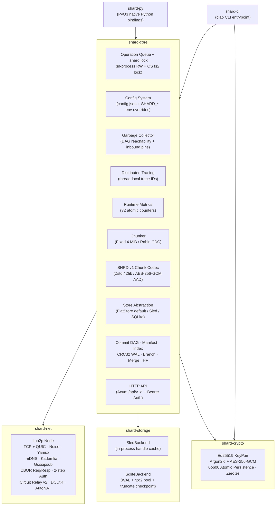
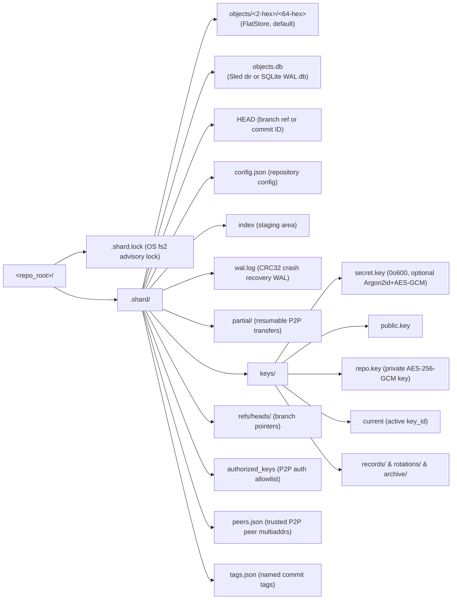

# Architecture

Shard is structured as a workspace of five decoupled crates plus native Python bindings (`shard-py`), orchestrated by `shard-core`.

## Component Diagram

## Storage Layout

Shard stores repository state inside `.shard/` and places the advisory OS lock file `.shard.lock` at the repository root (so even concurrent `shard init` calls are serialized).

## Key Design Decisions

| Decision | Choice | Rationale |
| :--- | :--- | :--- |
| **Chunking** | Fixed 4 MiB (default) or Rabin CDC (`--chunker rabin`) | Fixed for predictable I/O and peak throughput; Rabin CDC for byte-shift-resilient checkpoint dedup |
| **Compression & Encryption** | `SHRD` v1 self-describing 8-byte envelope (Zstd/Zlib/None + AES-256-GCM AAD) | Safe dedup across compression changes; AAD binds ciphertext to `chunk_id` |
| **Hashing** | Blake3 | SIMD-accelerated 256-bit cryptographic hash for content addressing and Merkle roots |
| **Signatures** | Ed25519 | Fast, compact 64-byte signatures with signed key rotation and trust-anchor verification |
| **Storage** | `FlatStore` (default), `Sled`, or `SQLite` | `FlatStore` for simple zero-dependency portability; `Sled`/`SQLite` for indexed single-DB storage |
| **P2P** | libp2p TCP + QUIC + Noise + Yamux | Mature encrypted transports with Circuit Relay v2, DCUtR, and AutoNAT |
| **Wire Format** | CBOR (request-response) + JSON (Gossipsub) | Compact binary framing for object transfer; inspectable pubsub announcements |
| **Concurrency** | In-process `RwLock` + `.shard.lock` OS advisory lock | Readers run in parallel, writers are exclusive across threads and processes |
| **Config** | JSON + `SHARD_*` env var overrides | 12-factor friendly with schema validation before repository mutation |
| **Tracing & Metrics** | Thread-local trace IDs + 32 static atomic counters | Correlate diagnostic logs on `stderr` and export health snapshots via `--json` |
| **GC** | DAG reachability + inbound pin scan | Marks reachable objects from HEAD, branches, tags, index, and active P2P pushes before pruning |
