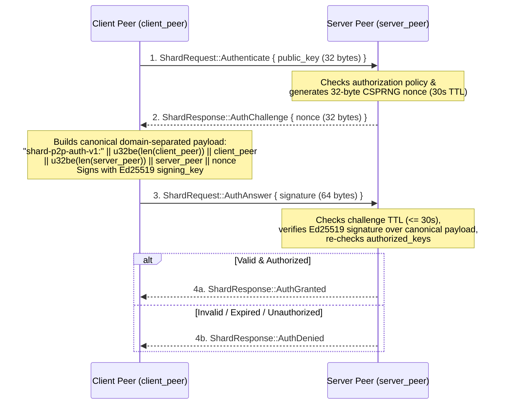

# Protocol Specification

This document details Shard's chunk envelope codec, P2P wire protocol, authentication handshake, rate limiting, and SSRF defenses.

---

## Discovery & Transports

Shard nodes run on `libp2p` with the following stack:

- **Transports**: TCP (`nodelay`) + Noise + Yamux, and QUIC (TLS 1.3), with DNS resolution.
- **NAT Traversal**: Circuit Relay v2, DCUtR (Direct Connection Upgrade through Relay), and AutoNAT.
- **Discovery**:
  - **DHT**: Kademlia (`kad`).
  - **LAN**: mDNS (gracefully disabled in multicast-restricted containers).
  - **Manual bootstrap**: `shard peer add <multiaddr>` (stored in `.shard/peers.json`).

---

## Data Model & `SHRD` v1 Chunk Envelope

All metadata objects (commits, manifests, key rotation records) are canonicalized and signed with Ed25519. Every object ID is strictly validated as a 64-character lowercase hexadecimal Blake3 digest.

### `SHRD` v1 Chunk Envelope (8-byte Header)

Chunks are addressed by `blake3(plaintext)` and stored/transferred inside a self-describing 8-byte envelope:

| Offset | Size | Field | Description |
| :--- | :--- | :--- | :--- |
| `0..4` | 4 bytes | `magic` | ASCII `SHRD` (`[0x53, 0x48, 0x52, 0x44]`) |
| `4` | 1 byte | `version` | Envelope version (`1`) |
| `5` | 1 byte | `flags` | Bits `0..2`: compression (`0 = none`, `1 = zstd`, `2 = zlib`) · Bit `2` (`0x04`): encrypted with AES-256-GCM |
| `6..8` | 2 bytes | `reserved` | Zero bytes (`0x00, 0x00`) |
| `8..` | variable | `payload` | Compressed bytes, or AES-256-GCM (`12-byte nonce || ciphertext || 16-byte tag`) with `AAD = chunk_id` UTF-8 bytes |

- **Swap resistance**: Binding `chunk_id` as AES-256-GCM AAD prevents an attacker from substituting one valid encrypted chunk for another.
- **Legacy compatibility**: Headerless pre-v2.4 chunks remain decodable via manifest compression metadata.
- **Wire size limit**: Maximum wire payload size is capped at `65 MiB` (`MAX_WIRE_CHUNK_SIZE`).

---

## 2-Step Ed25519 Challenge-Response Authentication

Shard runs a CBOR request-response protocol on `/shard/1` (`ShardRequest` / `ShardResponse`).

### Authorization Policy

- **Reads (`GetManifest`, `GetChunk`)**: Open when `.shard/authorized_keys` is absent; strictly gated on Ed25519 authentication when `authorized_keys` is configured.
- **Writes (`PutChunk`)**: Always require authentication against `.shard/authorized_keys` (repositories with no `authorized_keys` reject all P2P writes).

### Handshake Flow



- **Replay & MITM protection**: The signed payload binds the protocol domain (`shard-p2p-auth-v1:`), client `PeerId`, server `PeerId`, and single-use 32-byte server nonce.
- **Lifecycle**: Pending challenges expire after 30 seconds (`AUTH_CHALLENGE_TTL`). Authenticated session state is cleared immediately when all connections to a peer close (`on_connection_closed`), and authorization is re-checked against `authorized_keys` on every request so revoking a key takes effect immediately.

---

## Gossipsub Announcements & SSRF Defense

Nodes subscribe to:
- `shard:ann` (global announcement topic)
- `/shard/repo/<repo_id>` (repository-specific topic)

Payload (JSON-serialized `Announcement`):

```json
{
  "commit_id": "<64-char blake3 hex>",
  "file_count": 42,
  "total_size": 1073741824,
  "repo_name": "my-model",
  "peer_multiaddr": "/ip4/192.168.1.2/tcp/9876/p2p/<peer_id>"
}
```

### SSRF Protection in `shard sync`

To prevent malicious Gossipsub messages from tricking a node into dialing arbitrary internal IP addresses:
1. `shard sync` only considers announcements published on the repository's own `/shard/repo/<repo_id>` topic with a valid 64-hex `commit_id`.
2. `shard sync` **never** dials the untrusted `peer_multiaddr` string from an incoming announcement payload.
3. Auto-pulls only dial peers already present in the node's trusted `address_book` (populated exclusively from `.shard/peers.json`, LAN mDNS discovery, or established outbound dialed connections), bounded by a concurrency semaphore (`MAX_CONCURRENT_AUTO_PULLS = 4`).

---

## Sliding-Window Per-Peer Rate Limiting

Both `shard share` and `shard sync` enforce a sliding-window `PeerRateLimiter`:

- **Request-Response Limiter**: Controlled by `rate_limit_max_requests` (default `50`) and `rate_limit_window_secs` (default `60`). Each peer tracks request timestamps in a `VecDeque<Instant>`, evicting expired entries on check and pruning stale peer buckets every interval tick.
- **Announcement Limiter**: Caps incoming Gossipsub announcements in `sync` to `10` per peer per rate-limit window to prevent pubsub amplification floods.
- **Request Timeout**: CBOR request-response streams enforce a 60-second stream timeout and 30-second client request deadline.

---

## Fetch & Push Flows

### Pull Flow (`shard pull <multiaddr>/p2p/<peer_id> <commit_id>`)
1. Client connects to peer (performing 2-step Ed25519 auth if the peer requires it).
2. Client fetches commit object via `GetManifest(commit_id)`, verifies `blake3(data) == commit_id`, checks Ed25519 signature + `authorized_keys` trust rules, and traverses parent commits and file manifests.
3. Missing chunks are fetched in parallel via `GetChunk(hash)` and verified through `SHRD` v1 decoding + Blake3 plaintext hash check.
4. Partial progress is persisted under `.shard/partial/` for resumable transfers.

### Push Flow (`shard push <multiaddr>/p2p/<peer_id>`)
1. Sender collects all objects reachable from `HEAD` (commits, manifests, chunks, and key rotation records).
2. Sender completes 2-step Ed25519 challenge-response authentication with the receiver.
3. Sender streams each object via `PutChunk(ChunkPiece)`. The receiver verifies object integrity (`verify_wire_object`), persists it to its store, and records an inbound GC pin so background pruning cannot delete pushed objects prior to checkout. Push never mutates the receiver's `HEAD` or branch refs.
